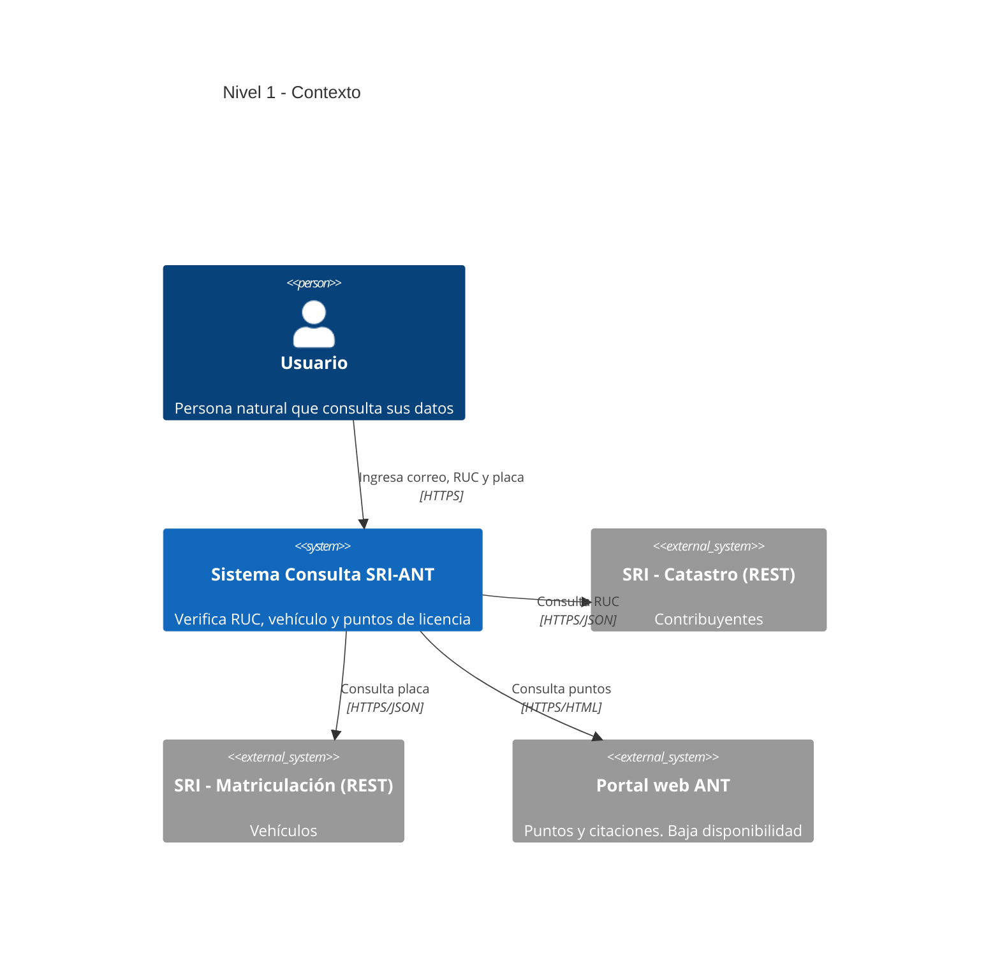
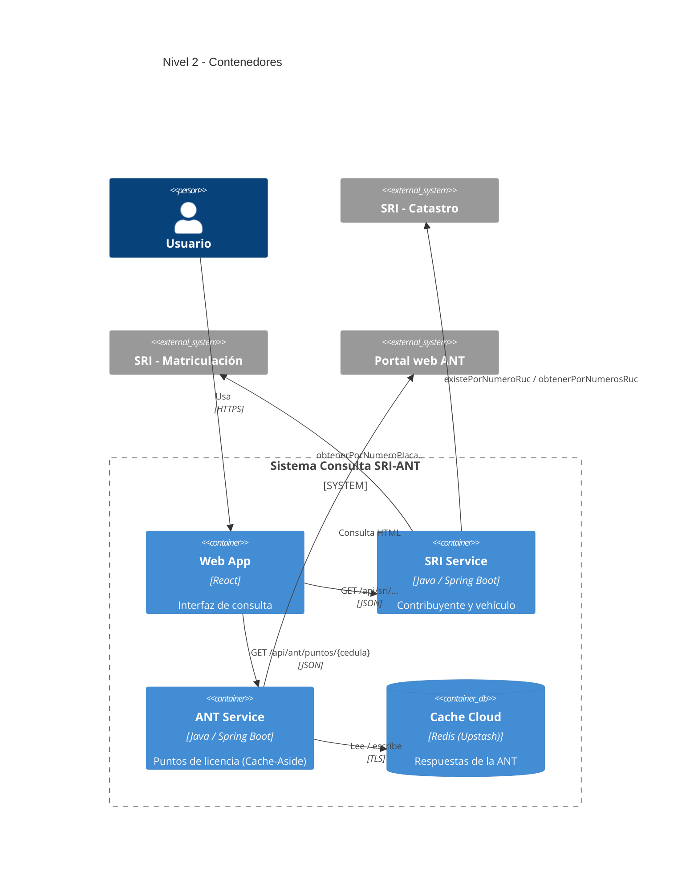
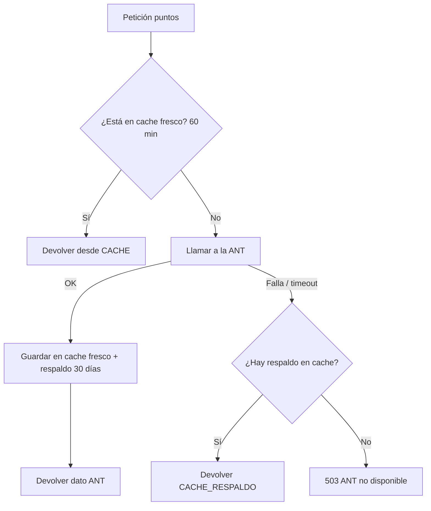

# Arquitectura C4

## Nivel 1 – Contexto

| Elemento | Tipo | Descripción |
|---|---|---|
| **Usuario** | Actor | Ingresa correo, RUC y placa del vehículo |
| **Sistema de Consulta SRI-ANT** | Sistema | Verifica contribuyente, vehículo y puntos de licencia |
| **API REST SRI – Catastro** | Sistema externo | `existePorNumeroRuc` y `obtenerPorNumerosRuc` |
| **API REST SRI – Matriculación** | Sistema externo | `BaseVehiculo/obtenerPorNumeroPlaca...` |
| **Portal web ANT** | Sistema externo (baja disponibilidad) | `clp_grid_citaciones.jsp` (puntos / citaciones) |

## Nivel 2 – Contenedores

| Contenedor | Tecnología | Responsabilidad | Repo / carpeta |
|---|---|---|---|
| **Web App** | React + Vite | Formulario correo/RUC → info persona → placa → vehículo + puntos | `frontend/` |
| **SRI Service** (microservicio) | Java 17, Spring Boot | Verifica contribuyente, persona natural y vehículo | `sri-service/` |
| **ANT Service** (microservicio) | Java 17, Spring Boot | Puntos de licencia con patrón Cache-Aside | `ant-service/` |
| **Cache Cloud** | Redis (Upstash / Redis Cloud) | Guarda las respuestas buenas de la ANT | servicio en la nube |

## Nivel 3 – Componentes (ANT Service)

| Componente | Clase | Qué hace |
|---|---|---|
| AntController | `AntController.java` | Expone `GET /api/ant/puntos/{cedula}?placa=` |
| PuntosService | `PuntosService.java` | Lógica del cache (Cache-Aside) |
| AntClient | `AntClient.java` | Llama a la web ANT y lee el HTML (Jsoup) |
| Redis Template | `StringRedisTemplate` | Acceso al cache cloud |

### Patrón Cache-Aside

